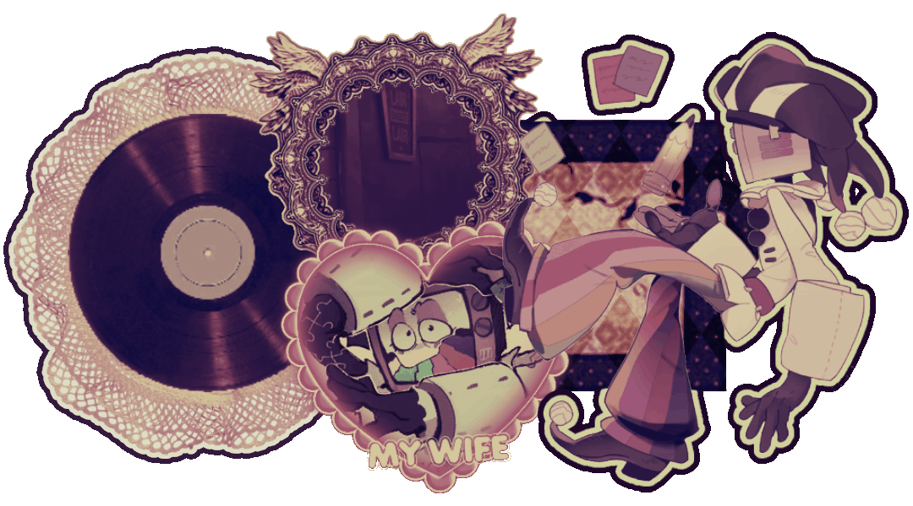

   

$\texttt{\color{#d5c3a2}I'm}$ $\texttt{\color{#ba928e}not}$ $\texttt{\color{#a45872}a badass,}$   $\texttt{\color{#87486f}I'm}$ $\texttt{\color{#4c2e50}not}$ $\texttt{\color{#ba928e}awesome.}$

information later
